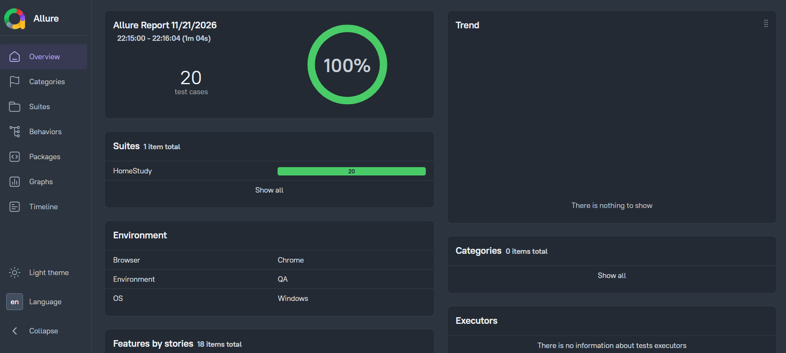
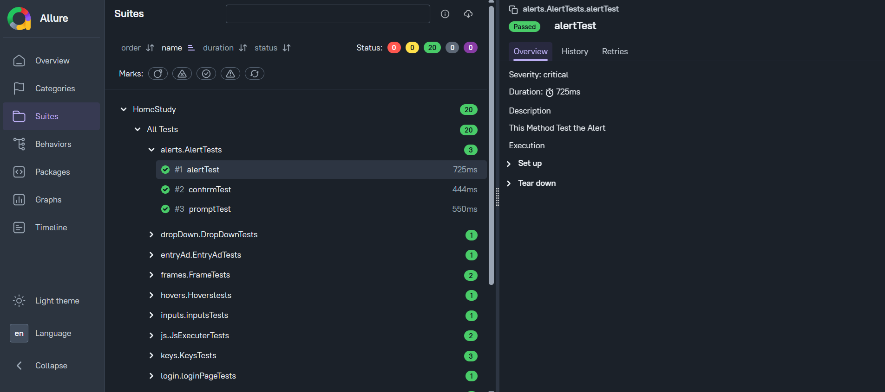
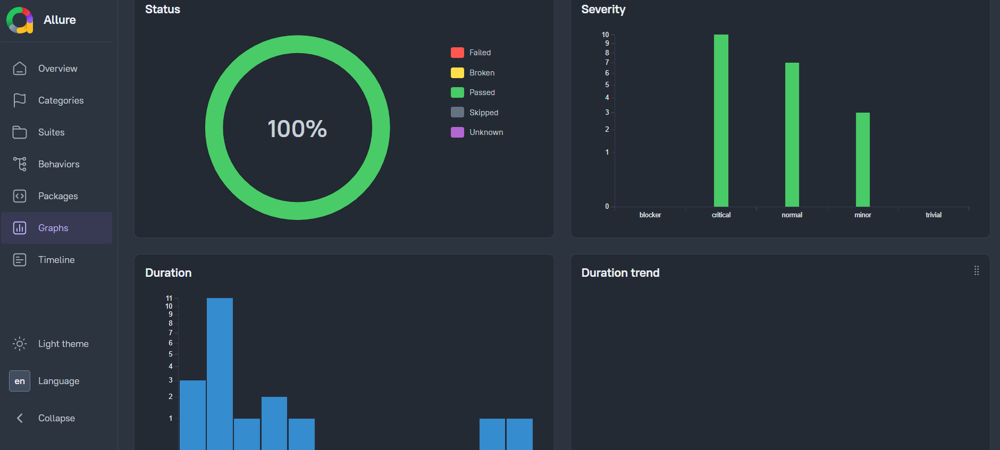

# The Internet Website – Selenium Automation Testing Framework

A Java-based UI test automation project built with **Selenium WebDriver**, **TestNG**, and the **Page Object Model (POM)**. The framework automates interactive features on [The Internet](https://the-internet.herokuapp.com/) and demonstrates browser automation, reusable test utilities, and test reporting with Allure.

> **Project focus:** maintainable UI automation for authentication, dynamic content, browser alerts, frames, windows, keyboard interactions, dropdowns, and file uploads.

## Tech Stack

| Technology | Purpose |
|---|---|
| Java 26 | Programming language (configured in `pom.xml`) |
| Selenium WebDriver 4.49.0 | Browser automation and UI interactions |
| TestNG 7.12.0 | Test execution, lifecycle annotations, and assertions |
| Maven | Dependency and build management |
| Allure TestNG 3.0.0 | Test execution reporting and metadata |
| Chrome / ChromeDriver | Browser used by the test setup |

## Framework Design

The project follows the **Page Object Model (POM)** to separate page-specific locators and actions from test scenarios.

- **`src/main/java/pages/`** – Page classes representing application pages and their available actions.
- **`src/main/java/utils/`** – Reusable Selenium helper methods and browser navigation/window management.
- **`src/test/java/`** – Test classes grouped by the feature under test.
- **`src/test/resources/`** – Test configuration, including Allure properties.

### Reusable utilities

- **`SelUtils`** centralizes common Selenium operations such as clicking elements, entering text, selecting dropdown options, handling JavaScript alerts, switching frames, uploading files, and scrolling to elements.
- **`WindowManager`** provides browser navigation actions and switching between windows by title.
- **`BaseTests`** initializes Chrome, navigates to the application home page before each test, and closes the browser after the test class.

## Automated Test Coverage

The project currently contains **20 TestNG test methods** across **13 test classes**.

| Feature | Test methods | Coverage |
|---|---:|---|
| JavaScript Alerts | 3 | Alert handling, confirmation dialogs, prompt text |
| Keyboard Actions | 3 | Text entry, Shift key interaction, Backspace |
| Frames | 2 | Left and bottom frame content |
| Dynamic Loading & Waits | 2 | Waiting for dynamically loaded content |
| JavaScript Executor & Actions | 2 | Scrolling to a table using JavaScript and Actions |
| Authentication | 1 | Login and secure-area navigation |
| Dropdowns | 1 | Selecting and verifying an option |
| Entry Ad | 1 | Handling the modal and checking the page header |
| Mouse Hover | 1 | Hover interaction and figure details |
| Inputs | 1 | Inputs page verification |
| Browser Navigation | 1 | Back, forward, refresh, and URL navigation |
| Multiple Windows | 1 | Switching to a newly opened window |
| File Upload | 1 | Uploading a file and verifying its filename |
| **Total** | **20** | **13 test classes** |

### Test Execution Summary

The repository contains 20 automated test methods. The table above describes the test suite implemented in the source code; it is **not a claim that all 20 tests passed in the latest run**. Actual Passed / Failed / Skipped counts should be added from a fresh TestNG/Allure execution report.

After running the suite, record the real results here:

| Execution metric | Latest run |
|---|---:|
| Total | 20 test methods in source |
| Passed | Add from latest Allure report |
| Failed | Add from latest Allure report |
| Broken | Add from latest Allure report, if shown |
| Skipped | Add from latest Allure report |

## Allure Report

Allure is integrated with TestNG to provide a visual report of test execution.

Run the tests first:

```bash
mvn clean test
```

The configured Allure results directory is:

```text
target/allure-results
```

Open an interactive report:

```bash
allure serve target/allure-results
```

Or generate a static report:

```bash
allure generate target/allure-results --clean -o target/allure-report
allure open target/allure-report
```

Make sure the Allure command-line tool is installed and available on your system.

### Allure Report Screenshots

Add screenshots from an actual execution to make the report easy to review without running the project.

## Allure Test Execution Reports

### 1. Allure Overview


### 2. Allure Test Suites


### 3. Allure Test Graphs

```

Only add screenshots from a real test run, and make sure any personal file paths or sensitive information are not visible.

## Project Structure

```text
Automation-Projects/
├── .gitignore
├── pom.xml
├── README.md
└── src/
    ├── main/
    │   └── java/
    │       ├── pages/
    │       │   ├── DropDownPage.java
    │       │   ├── DynamicLoadingPage.java
    │       │   ├── EntryAdPage.java
    │       │   ├── FileUploadPage.java
    │       │   ├── HomePage.java
    │       │   ├── HoversPage.java
    │       │   ├── InputsPage.java
    │       │   ├── JavaScriptAlertsPage.java
    │       │   ├── KeyPressesPage.java
    │       │   ├── LoginPage.java
    │       │   ├── MultipleWindowsPage.java
    │       │   └── ...
    │       └── utils/
    │           ├── SelUtils.java
    │           └── WindowManager.java
    └── test/
        ├── java/
        │   ├── alerts/
        │   ├── base/
        │   ├── dropDown/
        │   ├── entryAd/
        │   ├── frames/
        │   ├── hovers/
        │   ├── inputs/
        │   ├── js/
        │   ├── keys/
        │   ├── login/
        │   ├── navigate/
        │   ├── uploadFiles/
        │   └── waits/
        └── resources/
            └── allure.properties
```

## Prerequisites

Before running the tests, make sure you have:

1. **JDK 26** installed and configured. The Maven compiler source and target are set to `26` in `pom.xml`.
2. **Maven** installed and available from your terminal.
3. **Google Chrome** installed.
4. An internet connection to access the target website and resolve Maven dependencies.

Selenium Manager can help manage browser drivers. If automatic driver management does not work in your environment, configure a compatible ChromeDriver.

## Run the Tests

Clone the repository:

```bash
git clone <YOUR_REPOSITORY_URL>
cd Automation-Projects
```

Run the complete suite:

```bash
mvn clean test
```

## Notes

- The tests launch **Chrome** from the shared `BaseTests` setup.
- The file-upload test currently uses a local Windows file path. Update the `path` and `fileName` values in `UploadFilesTests.java` to point to a file that exists on your machine before running that test.
- Test results may be affected by the availability of the target demo website or changes to its content.
- IDE settings and generated Allure/report output are excluded from Git tracking through `.gitignore`.

## What This Project Demonstrates

- Applying the Page Object Model to organize UI automation code.
- Creating reusable Selenium helper methods to reduce duplicated actions.
- Automating common web UI components and browser behaviors.
- Working with dynamic elements, waits, alerts, frames, and multiple windows.
- Using TestNG annotations and assertions.
- Integrating Allure to produce readable test execution reports.

---

**Author:** Andrew Youssif Farid  
**Project:** The Internet Website – Selenium Automation Testing Framework
